# Library organization — PR #34

Latest refinement: [animated bookmark and favorite actions](#animated-bookmark-and-favorite-actions). Earlier measurements, APKs and captures below identify their corresponding source commits.

## Audit before implementation

Base: main `2034255f87dc2f1fe83fda2756054c84ffb5be68` (PR #33 merged).

- `core/LocalCollections.kt`: `LibraryEntry` owns a `PublicationSnapshot`, added time and optional last-opened time. Identity is the existing `(SourceId, localId)` `PublicationId`, never a title.
- `Collections.sq` / `SqlCollectionsStore`: one private SQLite database, SQLDelight schema v1. Android uses `AndroidSqliteDriver`; Desktop uses JDBC. Lazy open and queries are on IO. A monitor and SQLite transactions serialize reads, writes and close; 64 MiB page budget, FULL synchronous and foreign keys remain intact.
- `ApplicationCollections` owns successful-reader-open recording independently of screen disposal. History updates an existing Library entry's last-opened time. Removing History preserves this evidence; removing Library preserves History and progress.
- `ProgressPersistence` owns format-specific logical locators in independent private files. Organization must not rewrite, migrate or delete these files. Existing progress summaries can enrich sorting without changing locators.
- `CollectionsController` retains committed snapshots and existing multi-selection. `CollectionScreen` uses keyed cover-first lazy grids and shared cover leases; filtering must keep publication identities and avoid source/cover invalidation.
- Localization uses `UiText` and reviewed Compose Resources for en/es/ca. New UI will extend those tables, with no parallel translation system.

## Intended changes

Extend Library rows with stable reading-state IDs, explicit-state provenance and an independent favorite flag. Add a shared tag table and membership join table in the same database. Use a non-destructive v1→v2 transaction, infer reading only from existing recorded opens, retain manual choices, and perform batch edits atomically. Replace Library metadata row replacement with in-place update so tags survive refreshed source metadata. Tag deletion cascades only memberships.

Retain a bounded local search index per committed snapshot; normalize Unicode/case/accents off the UI thread. Combine search and filters with AND; selected tags must all match. Keep default added-date descending and deterministic source/local-ID ties. Query/filter state stays with the session across tab changes. Never issue catalog requests or invalidate covers for organization edits.

Implementation, verification results and physical acceptance checklist follow below as work completes.

## Implemented design

### Persistence and migration

- Schema v2 adds `reading_state`, `state_explicit`, `favorite` to `library_entries`, plus `library_tags` and `library_entry_tags` in the **existing** private database. Stable status keys: `not_started`, `reading`, `completed`, `paused`, `abandoned`.
- `1.sqm` is additive. Existing added dates, publication IDs, metadata children and History remain. Rows with recorded opens infer Reading once. A missing Library timestamp can reuse that publication's History timestamp. No percentage implies Completed.
- `databases/1.db` is an intentionally checked-in SQLDelight **schema-only test baseline with zero user rows**, not a runtime database or packaged user data. `jvmSharedTest/resources/collections-v1.sql` provides a readable baseline for a real JDBC upgrade test. Migration verification is enabled; the test opens a v1 file, upgrades it and reopens it after manual edits.
- Existing validated progress files also provide conservative reading evidence when Library first loads its summaries. This changes only implicit Not started rows. It never writes a locator or adds synthetic History. A manually selected Not started is protected too.
- `ApplicationCollections.recordOpened` remains the successful reader-open boundary. Metadata/details views do not count as reading. Automatic state changes only Not started → Reading when the state is implicit. All five manual choices persist and survive reopening. Completion is always manual.
- Source metadata refresh now updates the Library row **in place**, replacing only author/language children. It preserves organization, added date, last-opened time and tag membership. The History row-replacement behavior is unchanged. In-place update also avoids relying on SQLite UPSERT syntax unavailable on some supported Android versions.
- Shared tags have monotonically allocated numeric IDs. Names are normalized to Unicode NFC; surrounding/repeated whitespace and case are ignored for duplicate detection. Accented names are preserved. Deleting a tag removes only its assignments; deleting a Library entry keeps the tag and existing History/positions/files.
- Organization writes are deltas: nullable state/favorite mean unchanged; tag add/remove sets preserve unrelated assignments. Validate the entire batch and all tag limits before writing, then commit one transaction. Failure or pre-commit cancellation rolls back the whole edit. Concurrent independent favorite/state/tag edits are serialized and do not overwrite unrelated fields.
- Existing IO dispatch, foreign keys, FULL synchronous writes, 64 MiB database budget, failure reporting and unknown-future-schema refusal remain. No new database, dependency, permission, model or reader engine.

### Search, filters and sort

`LibraryBrowser` belongs to the retained `ApplicationSession`. It starts lazily on Library entry and keeps query/filter/sort state across tab visits. `CollectionScreen` retains the shell-owned keyed grid state. It never retains a screen, Activity or native bitmap itself.

A latest-only background computation prepares normalized title/author/tag text per committed snapshot. Query changes reuse that index. Unicode NFD + removal of combining marks + locale-independent lowercase + whitespace normalization give the same Android/Desktop search semantics. Whitespace-separated query terms must all match somewhere in the indexed metadata. User-entered text and publication metadata are never changed.

All filters combine with AND. Multiple selected tags require **all** selected tags. Untagged clears tag choices; choosing a tag clears Untagged. Reset filters keeps the query and sort. The separate clear-search icon keeps filters. Empty Library and no matches have different messages; no matches offers an appropriate reset or clear action.

Sorts: added date (existing default, descending), latest recorded open/locator timestamp, normalized title, normalized author and latest saved progress. Every sort supports ascending/descending. Missing authors/timestamps/progress remain after known values in either direction. Ties always use original source ID and local ID ascending, independently of interface language.

The existing progress-file lookup gains a read-only Library-sized request path. It still performs a single bounded directory scan, retains the existing file/byte/scan budgets and cancellation, and chooses the newest valid locator per requested publication. It never scans per keystroke. Session progress merges on Library presentation, so returning from a reader updates progress sort without resetting locators. Unknown progress stays unknown.

### UI and bounds

- Search, clear action, filters, sort and tag management are in the scrollable grid header. This keeps results reachable in short landscape windows with large fonts. During multi-selection the header is collapsed, with query/filter/sort state retained, leaving room for selected covers and batch controls. Cover-first tiles and their keys, resident artwork and lease ownership remain unchanged.
- Details for saved publications expose Organize and a quick Favorite toggle. No permanent tag/status badges cover the artwork.
- Organize edits one publication or selected publications. Batch fields begin as Keep unchanged; per-tag actions cycle Keep unchanged → Add → Remove. Other fields remain untouched. New tags can be created from the panel and reused immediately.
- Manage tags creates, renames and deletes shared tags. Delete asks for confirmation. Deleting a tag prunes only that tag from active filters and pending assignments, retaining other query/organization fields. The existing Library removal confirmation/behavior remains separate.
- Viewport-constrained dialogs have scrollable content, safe-drawing/IME insets, fixed wrapping actions and localized screen/role/state labels. Escape closes the modal first; the initial close-button focus supports keyboard dismissal.
- Library storage and search support **5,000 publications** within the unchanged database byte budget; 100 shared tags, 64 Unicode code points per name, 20 tags per publication, 256 search characters. No automatic tag categories.
- Existing multi-selection/removal stays bounded to **1,000** entries. When more matches exist, its action explicitly says Select first 1,000 matches. This preserves the previous deletion batch contract. The repository's atomic organization API is separately tested with 5,000 entries.
- Query/filter/sort are session UI state, not new persistent preferences. Organization survives restart. Full process-recreation persistence of search/filter state is outside this PR.
- New strings extend existing `UiText`/Compose resources in en/es/ca. External titles, authors, tags and book contents retain their original text. Language changes do not re-key cover requests or reopen reader engines.

## Regression and performance verification

The first full Desktop attempt caught two issues during development: a fixed header could leave no grid height at 360×400 with enlarged text, and older UI tests mistook the new search field's legitimate text-selection long-click for a cover. The header now scrolls with the grid. Existing cover tests target the cover's accessible identity while retaining their original selection/navigation/acquisition assertions.

Automated coverage includes real v1 migration/reopen, all manual states and conservative opens, shared Unicode tag CRUD, duplicate/capacity validation, unchanged metadata/history, canceled/failed transactions, simultaneous delta updates, 5,000-row storage/batches, title/author/tag search, combined filters, every sort/tie/missing value, stale work rejection and no query-driven repository refresh. Headless shared-UI tests exercise real screens/dialogs with three language tables, light/dark appearance, 320/360 dp widths, 400 dp height, Desktop width and font scales up to 180%, plus clear/search/filter/details/organization, errors, modal keyboard dismissal and navigation retention.

Host measurements use original synthetic records, no publication payloads and no live provider. `LibraryQueryPerformanceTest` measures index creation, search + AND filters, and a batch of all five sorts for 10/100/1,000/5,000 rows. One index is reused for seven query/sort repetitions. Results include JVM/JIT/GC/scheduler effects; they are neither Android frame timings nor a cold-start, native-memory or realme C55 benchmark. Full results are recorded after final verification below.

No measured claim about device FPS, touch latency, native peak memory or scrolling under concurrent translation is made. The existing 1,000-publication cover/scroll regression, bounded cache tests and complete reader/security suites remain part of verification. The 5,000-row CPU/storage tests do not prove 5,000-row physical-device fluidity.

## Physical Android acceptance checklist — realme C55

Install the development-signed APK **over** the previous installation. Do not uninstall or clear application data.

1. Before updating, note a few Library titles, History entries and exact EPUB/CBZ/PDF/TXT positions. After update verify they remain and reopen each format. Previously opened Library entries should infer Reading; untouched ones should be Not started. No entry should infer Completed.
2. Search a title, an author and an accented tag with different case/accents. Clear only search and confirm active filters stay. Try a missing term, then recover without losing entries. Repeat offline; no catalog request is required.
3. Manually set each state, including Not started, then read/reopen it. Confirm the state remains. Mark Completed and Favorite independently; reopen at the same saved position.
4. Create a Unicode tag, assign it to two publications, rename it, then delete it. Both assignments must update; both books, files and locators must remain. Attempt duplicate/blank/overlong names and confirm understandable errors.
5. Combine Reading + Favorites + two tags. Only entries matching **all** conditions should appear. Reset filters, clear search separately, and exercise every ascending/descending sort, including missing-author/progress entries.
6. Long press, select several filtered matches, and apply a state/favorite/tag delta. Other fields must remain. Check the selected-count/1,000-item limit and existing removal confirmation without deleting original files.
7. Switch Library → Home → History → Search → Settings → Library. Query, filters, sort and a valid scroll position should remain. Restart and confirm organization persists (query/filter state may reset).
8. Repeat in español, English and català; test font scales 150–180%, portrait/landscape, light/dark, keyboard/TalkBack where available. All panel content must scroll and all close/apply actions remain reachable.
9. Scroll quickly with warm and pending artwork, then filter/sort repeatedly. Look for duplicated cover requests, jumps, frozen frames or exits. Repeat with the largest existing library; do not import copyrighted test fixtures into the repository.
10. Exercise EPUB selection/translation, models, Original/Translated, CBZ rapid/RTL/double-page navigation and PDF/TXT reading. Record any position or responsiveness regression. Physical acceptance is required before merge.

## Final verification — 2026-10-21

Code verified: `fd9ce603ce4001804e2681a4112d25ec43376913`.

| Suite | Tests | Failures / errors / skipped |
|---|---:|---:|
| Desktop | 1,616 | 0 / 0 / 0 |
| Android-host | 1,353 | 0 / 0 / 0 |
| Core JVM | 59 | 0 / 0 / 0 |
| Core Android-host | 59 | 0 / 0 / 0 |
| **Total** | **3,087** | **0 / 0 / 0** |

Clean app/Android build outputs were regenerated. Android debug assembly, Desktop compilation, SQLDelight historical migration replay and `verifyDebugLanguageResources` passed. `tools/check_localization.py`: **453 strings + 2 plurals per language**, en/es/ca, presentation literal guard passed. `git diff --check` passed. No tests/assertions were removed or disabled.

The final headless UI fixture includes 5,000-entry scroll/search/tab restoration, 320/360 dp widths, a short 360×400 viewport, Desktop width and font scaling to 180%. It exercises deleted-tag filter/pending-edit cleanup and keyboard modal dismissal. Images are original synthetic previews, not Android device screenshots. A remaining older viewport test was adapted to locate its target publication in the real deterministic sort rather than assuming an insertion-order index; its visibility and navigation assertions remain.

### Reproduce

With the repository's supported JDK and Android SDK:

```sh
./gradlew :core:jvmTest :core:testAndroidHostTest \
  :app:desktopTest :app:testAndroidHostTest \
  :app:verifyCommonMainLocalCollectionsDatabaseMigration \
  :androidApp:assembleDebug :androidApp:verifyDebugLanguageResources \
  :desktopApp:compileKotlin
python3 tools/check_localization.py
git diff --check
```

The managed Linux environment used JDK 21, three visible CPUs, the configured proxy/CA wrapper, and an external test init script selecting a verified preinstalled Skiko native library because the home directory is read-only. Test tasks were forced to rerun. This changes environment setup, not test assertions. Pre-existing SDK-location/metrics-home and prebuilt-symbol-stripping warnings were non-fatal. No emulator or physical Android was available.

To collect optional original-fixture host reports, set `INFINILECT_LIBRARY_METRICS` to an **absolute external output directory** and run `LibraryQueryPerformanceTest` / `LibraryOrganizationStoreTest`. `INFINILECT_LIBRARY_PREVIEWS` optionally writes synthetic PNGs outside the repository. Reports use the test task's platform name when supplied as `infinilect.test.platform`; otherwise it is `jvm`. No publication contents or personal data are collected.

### Host measurements

Same Desktop JVM suite, same original metadata fixture, seven repetitions per size, wall-clock milliseconds. These samples include JIT/GC/scheduling effects and are **not Android measurements**. Sorting column measures all five sorts together. Index preparation is reused across query changes.

| Publications | Index median (ms) | Search + AND filters median (ms) | Five sorts median (ms) |
|---:|---:|---:|---:|
| 10 | 0.068 | 0.002 | 0.012 |
| 100 | 0.429 | 0.011 | 0.078 |
| 1,000 | 2.446 | 0.078 | 0.708 |
| 5,000 | 10.649 | 0.367 | 2.542 |

At 5,000 rows, search/filter min–max was **0.296–1.670 ms**; index creation **9.792–19.745 ms**. Five real 5,000-row atomic favorite updates took **171.423, 201.127, 166.222, 183.613, 157.520 ms** (median **171.423 ms**), including IO scheduling, validation and FULL synchronous SQLite commits. This tests the repository API; the existing UI selection/removal cap remains 1,000. These results provide reproducible capacity/correctness evidence, not a before/after FPS claim or a guarantee of realme C55 latency.

### Artifact and delivery checks

- Fresh debug APK assembled and aligned for 16 KiB; v2 signature verifies; package remains `org.infinilect.app`, minimum API 26, original four ABIs.
- Six packaged locale CVR files exactly match generated resources. The historical database fixture, test SQL and test classes are absent from the APK. No private key files are packaged.
- All **six** packaged native libraries are byte-identical to the previous PR #33 development APK; network notices and public-suffix resource are preserved.
- No runtime dependency, permission, application ID, release or signing-configuration changes. The only committed `.db` is the intentionally empty historical schema verification input.
- **Same-certificate APK delivered privately via Drive:** `INFINILECT-PR34-c3cd85f-development.apk`, built from `c3cd85fad1f21b6b7411fc0d4074d8b9be9ea9f5`, 20,821,558 bytes. SHA-256: `55e51bfdd26210a110ae86304d8a2276ab144efe58ee58693da6753c3d45eae6`. The supplied original development certificate matches the preceding installation; v2 signing and 16 KiB alignment verified. Drive metadata confirms the byte count and owner-only access. No signing inputs were committed or uploaded. Install over the previous version without uninstalling or clearing data; physical upgrade validation remains pending.

### Remaining acceptance limits

Physical validation on realme C55, Android-native migration/touch/TalkBack/IME behavior, device frame times and native peak memory remain unverified. The full host suites and compilation do not substitute for that acceptance. The existing progress-file quota, History retention, translation model/cache budgets and cover memory/concurrency bounds remain unchanged; 5,000 Library metadata entries do not increase those independent storage budgets. Query/filter/sort survive tab changes, but are not persistent process-restart preferences. Keep PR #34 Draft until code review and physical acceptance.

## Compact visual refinement after realme C55 acceptance

The supplied seven-panel reference is a composition guide, not catalog data. No book artwork, invented progress, tag colors or sample titles from it are bundled. Existing `CollectionScreen`, `LibraryTools`/`LibraryOrganizer`, cover leases, `PublicationDetails` and theme resources are reused; there is no new persistence or visual framework.

Design guide: 12 dp grid edge, 8 dp gutters, 10 dp row gaps, aspect-preserving 2:3 artwork, two-line caption titles below artwork; no Library title scrim. Original 22 dp outline glyphs have 48 dp action targets and public Foundation tooltips. Existing theme colors provide the turquoise accent and light/dark contrast. Quick filter chips have wrapping text; the four shortcuts scroll horizontally. The tools header remains a lazy full-span grid item so it cannot starve covers on short windows. Normal 360 dp phones use three columns, 320 dp uses two; minimum tile width grows with font scale and Desktop uses wider tiles. Below 320 dp a single column is permitted when needed. At 320 dp and above, at least two columns remain available even with 180% text. Artwork height is capped on short viewports (image stays fitted, never stretched) so the two-line title remains reachable. Tile dimensions are computed once by the grid, without per-tile constraint subcomposition.

| Before | After |
| --- | --- |
| Large labeled search and three text actions | Placeholder search, four quick chips, count and icon tools; tags in overflow |
| Two large covers with overlaid title scrims | Adaptive denser grid, full fitted artwork, two-line title below |
| Persistent organization-success row shifts content | Short accessible Snackbar overlay, no fake Undo; failures remain persistent |
| Reading/removal/organization/favorite compete | Full-width primary reading action; heart and organization secondaries; confirmed removal in overflow |
| Long radio/checkbox sections | Wrapping state/tag chips and independent favorite switch; batch deltas stay atomic |
| Wrapping selection toolbar with long text actions | Count and quick organization/favorite icons; select-all and confirmed removal in overflow |
| Two action rows per tag | Name/count and two labeled icon actions; global rename/delete behavior unchanged |

Filters remain immediate and use the same session `LibraryQuery`; quick Reading/Completed toggle the state component, Favorites toggles its independent flag, All clears filters while preserving search/sort. Selected tags still use AND and Untagged excludes named-tag filters. Sort and deterministic ties are unchanged. Library/History details and local Home details share the action hierarchy; provider acquisition restrictions and notices remain intact. Synopsis, source rights/reference and jurisdiction notice remain scrollable and unchanged in meaning.

No reader, schema, model, network/cache/concurrency budget, permission or dependency is changed. Grid items remain keyed by publication identity, use existing viewport-aware cover leases, and retain the caller-owned scroll state. Tag usage counts derive once per committed Library snapshot with no database queries in composition. Favorites and explicit completion are separate subtle artwork-corner indicators; unknown progress never implies completion.

Verification and current APK information for this refinement are recorded below when complete. Previews are raster captures of the actual shared Compose UI with original synthetic test data, not generated designs or physical Android evidence. realme C55 touch, TalkBack, gesture navigation and perceived performance remain physical acceptance requirements.

### Physical visual acceptance checklist — realme C55

1. Upgrade in place with the original development certificate; keep Library, History, organization and saved positions. Never uninstall or clear data to test this PR.
2. At normal font size, inspect the compact search, four quick chips, count/icon toolbar and approximately three columns. Check full artwork and titles beneath it; no title scrims or permanent menus on covers.
3. Search locally, clear, combine Reading + Favorites + tag filters, then change advanced state and reset. The quick chips must agree and reset must preserve the search/sort.
4. Change each sort/direction; return from details and from another tab. Scroll and query should be retained. Repeat while covers are pending/failing and recommendations load on Home.
5. Open an unread and a previously read publication. Check Start/Continue, actual progress, favorite/organization controls, removal only via overflow and confirmation. Cancel removal and verify the source file and progress remain intact.
6. Change state, favorite and tags individually and in a multiple selection. Save once; verify the short overlay disappears without moving the grid. Trigger an invalid tag name/storage failure if safely available and verify the persistent error is readable and no partial change is saved.
7. Create a Unicode tag, assign it to two books, check the usage count, rename globally and delete the tag. Both books and positions must remain.
8. Repeat in es/en/ca, light/dark, portrait/landscape and 150%/180% fonts. Scroll dialogs to their end, keep close/apply reachable with keyboard visible, check icon labels with TalkBack and Desktop Tab/Enter/Escape.
9. Open EPUB/CBZ/PDF/TEXT and return; verify positions, EPUB selection/translation and History. Confirm all source-rights and jurisdiction notices remain reachable in details.

Same-certificate delivery for this new visual refinement requires the original signing attachments to be available in the execution environment. The earlier signed APK documented above predates this redesign and must not be represented as its test artifact. Debug compilation alone does not establish upgrade signing or physical acceptance.

### Rendered previews

These are **headless captures of the actual Compose implementation**, not generated mockups, installed-Android screenshots or realme C55 evidence. Publication names, the `Estudi 📚` user tag, artwork and reading records are original synthetic fixtures. The application-shell captures include real cover loading/fallback states. Reference artwork and illustrative reference catalog data are not used.

| Library, dark — 390 dp | Library, light — 390 dp |
| --- | --- |
| 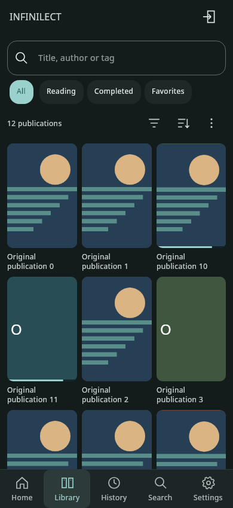 | 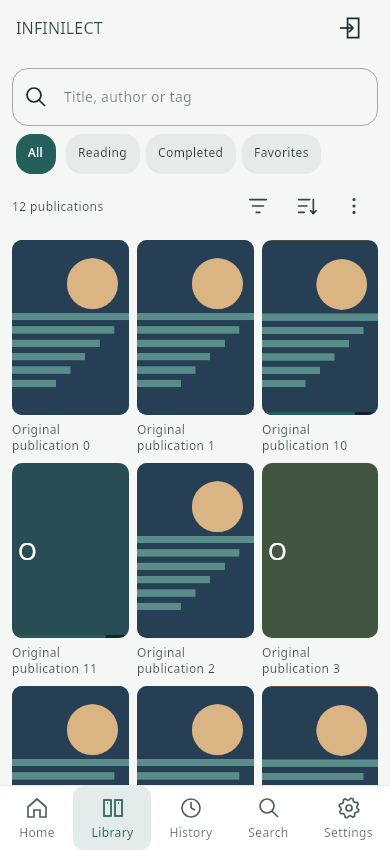 |

| Filters (immediate) | Sort | Single organization |
| --- | --- | --- |
| 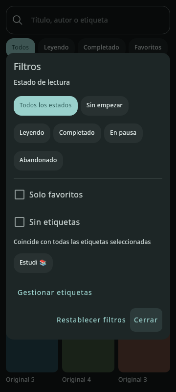 | 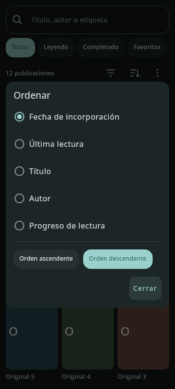 | 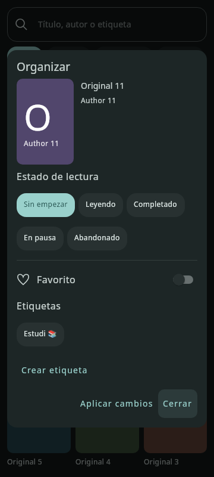 |

| Details with actual saved fixture progress | Multiple selection | Tag usage count |
| --- | --- | --- |
| 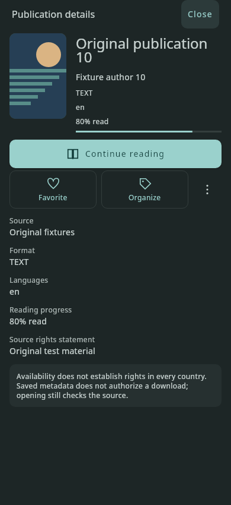 | 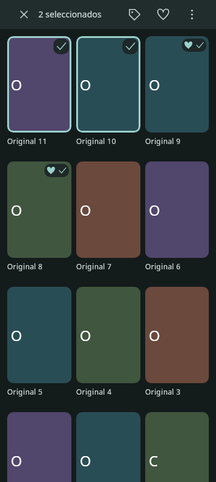 | 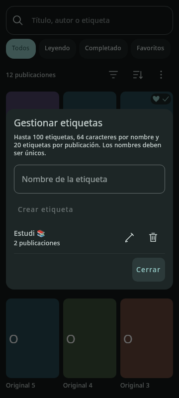 |

Same Catalan organizer fixture at 320×720 dp / 180% font scale, before and after:

| Before | After |
| --- | --- |
| 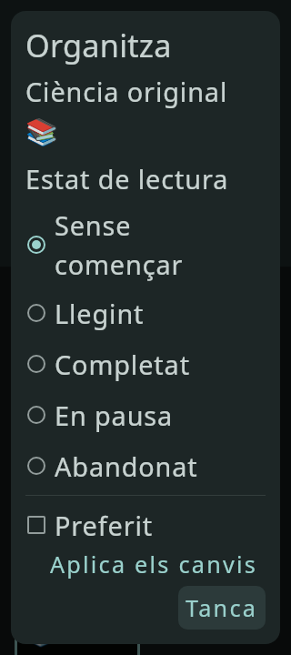 | 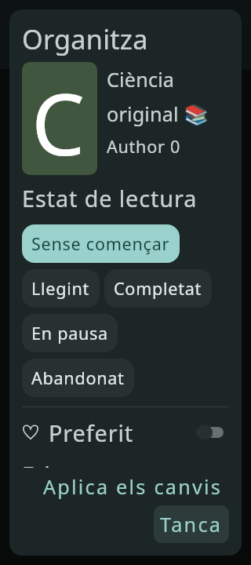 |

Additional captures: [Desktop Library](previews/pr34/library-desktop.png), [light-theme details](previews/pr34/details-light.png). Reproduce with `INFINILECT_UI_PREVIEW_DIRECTORY=/absolute/path` and `INFINILECT_LIBRARY_PREVIEWS=/absolute/path` while running `ApplicationInterfaceTest` and `LibraryOrganizationInterfaceTest` on Desktop, with the verified Skiko native library available. No image-generation tool is used.

### Final verification of the visual refinement

Verified source commit: `a5ce9629739f68f3349b5a3f4b719653028bb76c` (later commits only document results and captures).

| Suite | Passed | Failures / errors / skips |
| --- | ---: | --- |
| App Desktop | 1,621 | 0 / 0 / 0 |
| App Android-host | 1,353 | 0 / 0 / 0 |
| Core JVM | 59 | 0 / 0 / 0 |
| Core Android-host | 59 | 0 / 0 / 0 |
| **Total** | **3,092** | **0 / 0 / 0** |

The final combined run completed successfully in 11m37s, including `:core:jvmTest :core:testAndroidHostTest :app:desktopTest :app:testAndroidHostTest :androidApp:assembleDebug :androidApp:verifyDebugLanguageResources :desktopApp:compileKotlin`. Tests were forced to execute with the environment's test-native init script (verified Skiko path); no assertions were disabled, skipped or weakened. `python3 tools/check_localization.py` and `git diff --check` pass: **457 strings and 3 plurals per en/es/ca**. No runtime dependency/permission/signing/reader/schema changes were found.

UI checks include real compact search/clear, quick ↔ advanced query synchronization, all sort controls, two/three-column density, separate artwork/title geometry, large-text short windows, favorite and confirmed removal, single/batch organization, tag usage, transient success without grid movement, errors retained, keyboard dismissal, 5,000-row virtualization and session restoration. Existing migration, byte-preserved locators, reader/security/source/translation regressions pass. The new publication plural is explicitly checked for zero/one/many in each language. Material popup exit animations use the controlled test clock; focus is placed on opening and restored after keyboard dismissal. Explicitly owned overflow state makes dismissal close the open child menu before its details/selection parent.

Debug APK audit: **21,366,607 bytes**, SHA-256 `89399771048140fbc95de0453fd9ea6f26ae15302b8125184a7e5b238209906b`, built from the source commit above. Package/minimum API/four ABIs unchanged; v2 signature and 16 KiB alignment verify; all six locale CVRs match generated resources; test/schema fixtures and private key files are absent; all six native libraries match the prior PR #33 development APK byte-for-byte. This artifact is signed by the environment debug key, **not the user's update certificate**, so it is not distributed as an upgrade. Original signing inputs must be reattached to produce the install-over artifact; signing configuration remains unchanged.

These are host tests, build and artifact checks. No physical Android interaction, TalkBack, realme C55 frame timing or native peak-memory measurement was performed. Keep Draft pending the manual checklist and same-certificate delivery; do not uninstall, erase data, merge or publish a release.

## Animated bookmark and favorite actions

The subsequent realme C55 report confirms the compact organization UI works. This follow-up keeps the existing database, repositories, source/acquisition rules and readers unchanged.

`PublicationDetails` now hosts one shared `PublicationOrganizationActions` row for Library, History, local Home, imported publications, discovery and legacy catalog details. A 48 dp bookmark directly adds metadata or opens the existing membership-only removal confirmation; there is no large Add button or duplicate removal menu. The reading action remains full-width and source restrictions still determine whether it exists. A heart and compact Organize icon appear only for an actual Library member with a loaded Library entry.

Both controls use `OrganizationToggle`: original outline vectors, a 220 ms color/fill transition and a short drawing-only scale pulse (activation peak 1.15; deactivation 0.96). The target, focus and surrounding layout never scale. An active bookmark uses the theme accent; an active heart uses coral (`#B93848` in light, `#FF8A91` in dark). Nothing animates indefinitely or pulses on initial composition. Animation is informative only: filled/outline shape and accessible selected state identify the value without color or motion. Compose's public `MotionDurationScale` is respected, including zero; Android supplies its animator-duration policy. Desktop honors a supplied Compose duration scale but no cross-desktop OS preference detector is added.

The details row reads controller membership and committed Library entries directly, without an optimistic Boolean mirror. Existing synchronous controller guards reject duplicate writes before the next frame; the buttons are disabled during pending changes. Favorite is also disabled while a fresh Library snapshot is loading. A successful membership operation produces a short local Snackbar only after its job completes and the committed state agrees; failure keeps the previous icon and persistent localized error. An unavailable store exposes the existing Retry Library action. Controller-owned operations can complete after a dialog is closed, while the dialog-owned feedback observer is canceled. Reopening reads current state, not a stale callback.

In the **single-publication organizer**, the heart lives beside title/cover and edits the nullable pending favorite delta. Closing discards it; Apply commits state, favorite and tag deltas in the same existing transaction. Batch organization retains its explicit unchanged/add/remove choices so mixed values are not flattened accidentally. No new persistence, tables, model, schema or preference is introduced.

Accessible Add/Remove Library and Add/Remove favorites names use reviewed en/es/ca resources, selected-state semantics and public tooltip/focus/keyboard handling. Icon targets remain at least 48×48 dp and large text does not create another permanent row.

### Physical checks for these actions

1. Upgrade with the existing development certificate. Open details from Home, Library, History, Search/discovery and an imported file; verify one primary Read button and compact metadata actions, with rights notices intact.
2. On an unsaved publication, verify empty bookmark and no heart. Add once, then tap rapidly; only one metadata write should occur. Verify filled bookmark after success, Snackbar, and heart/Organize availability.
3. Tap filled bookmark: Cancel must keep it filled and retain all data. Confirm removes membership only; the open details must then show an empty bookmark. Check History, original/local imported files and saved position remain.
4. In saved details, toggle heart, reopen details/organizer and check the committed value and Favorites filter. In organizer toggle heart then Close: discard; repeat with Apply alongside a state/tag change: save all together.
5. Test offline Library membership, controlled storage failures/Retry if safely available, navigation while pending, external/batch favorite edits and return to details. A failure must not leave a false filled icon.
6. Check small/large windows, es/en/ca, light/dark and 150–180% text. With Android animations disabled, state changes must remain clear; with animations enabled they should be brief and unobtrusive. Validate TalkBack and keyboard activation. No physical validation of this follow-up is claimed by host captures/tests.

Verification results and the new signed APK are recorded below. Earlier APK/capture entries describe their respective older source commits; the current signed delivery resolves the earlier missing-signing-input limitation.

### Captures of the compact actions

These are real shared-Compose **headless renders with original synthetic data**, not physical Android screenshots or generated mockups. The light favorite capture deliberately shows a confirmed coral heart and success Snackbar.

| Saved details, dark | Saved details, light | Confirmed favorite, light |
| --- | --- | --- |
| 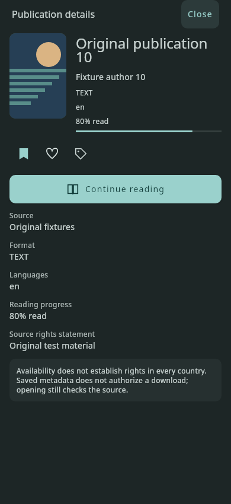 | 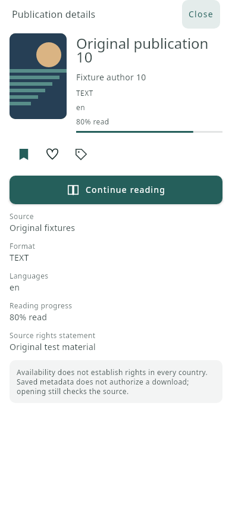 | 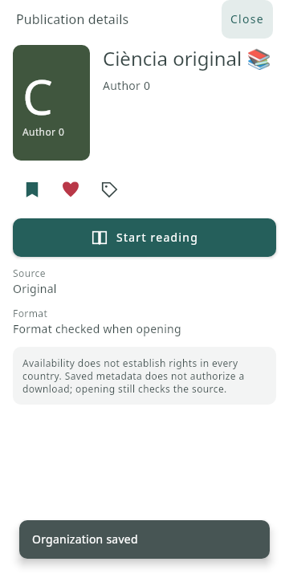 |

| Single organizer with header heart | Catalan, 320 dp / 180% text |
| --- | --- |
| 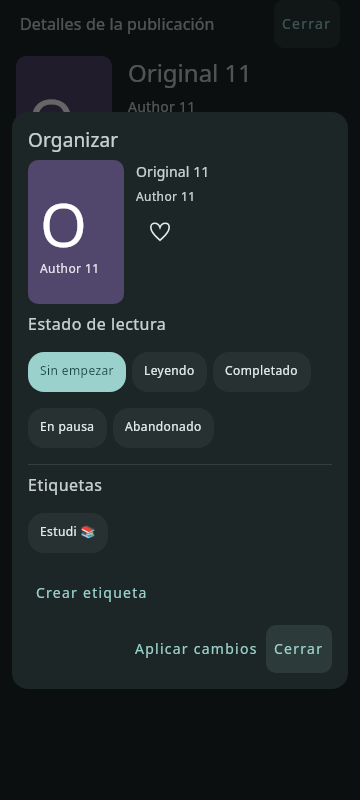 | 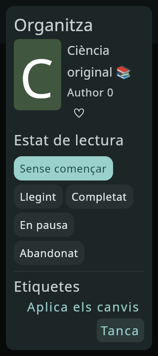 |

### Verification and install-over artifact

Verified runtime source: `0f99f07acc8634b0a2ae3c218a43fce019d18874`. Subsequent commits contain documentation and captures only.

The focused shared-UI and animation run passed **80 tests**. Coverage includes real pointer bursts during blocked writes, confirmation/cancellation, add/remove persistence failures and Retry, external membership/favorite updates, reopening after a commit, preserved History, organizer Close versus atomic Apply, Favorites filter synchronization, and navigation while writes remain pending. Animation checks compare rendered pixels, stable target bounds and selected semantics for both icons, light/dark themes, large fonts and zero/default motion duration scales.

The complete Android-host suite passed **1,353 tests**, Core JVM **59**, and Core Android-host **59**, with no failures, errors or skips. Android debug assembly, Desktop compilation and packaged-language verification passed in the same combined run. The localization guard passes with **461 strings and 3 plurals per en/es/ca**. `git diff --check` passes; dependencies, permissions, signing configuration, reader engines and persistent schema remain unchanged.

The first combined run (11m53s, using Gradle `--continue`) failed one Desktop test: `PageSpreadLayoutTest.fastEdgeSwipesDoNotNeedRepeatedAttemptsWhenFinalMovementArrivesOnPointerUp`, at fixture initialization (`Spread 0 must be fully presented`), before its gesture assertion. The unchanged test passed in isolation (45s), then the **complete Desktop suite passed in 9m42s**. No timeout, assertion or reader code was modified. The cause of the initial host timing failure is not established; this is not evidence of a physical Android failure or fix. Both outcomes are retained rather than reporting the first combined run as successful.

Final suite reports, with no source changes between these runs:

| Suite | Passed | Failures / errors / skips |
| --- | ---: | --- |
| App Desktop | 1,625 | 0 / 0 / 0 |
| App Android-host | 1,353 | 0 / 0 / 0 |
| Core JVM | 59 | 0 / 0 / 0 |
| Core Android-host | 59 | 0 / 0 / 0 |
| **Total** | **3,096** | **0 / 0 / 0** |

Reproduction tasks: `:core:jvmTest :core:testAndroidHostTest :app:desktopTest :app:testAndroidHostTest :androidApp:assembleDebug :androidApp:verifyDebugLanguageResources :desktopApp:compileKotlin`; the final full repeat ran `:app:desktopTest`. Tests were forced to execute with the managed environment's verified Skiko native path; no tests were excluded or skipped.

The new **same-development-certificate** APK includes these actions and the preceding Library redesign: `INFINILECT-PR34-512cabe-development.apk`, **21,386,806 bytes**, SHA-256 `76e565cc076324bd9474126128f1854ce0ef565214a5318a68e475cff0d0233e`. It was built at documentation checkpoint `512cabef3c54f796da99d74bc88443a3fd275716`, whose runtime source is the commit above. The signer matches the original supplied certificate; v2 signature and 16 KiB alignment verify. Package `org.infinilect.app`, minimum API 26 and all four existing ABIs are unchanged. All six packaged locale CVRs match generated resources; all six native libraries match the preceding PR #33 artifact. Test fixtures and private signing inputs are absent from the APK and repository. Private Drive delivery was verified by uploaded size and owner-only permissions; no release or public sharing was created.

These results establish host behavior, compilation and artifact integrity. Physical Android touch/TalkBack, realme C55 performance and the install-over flow still require the checklist above. Keep the PR in Draft; do not uninstall, erase data or merge for this delivery.
